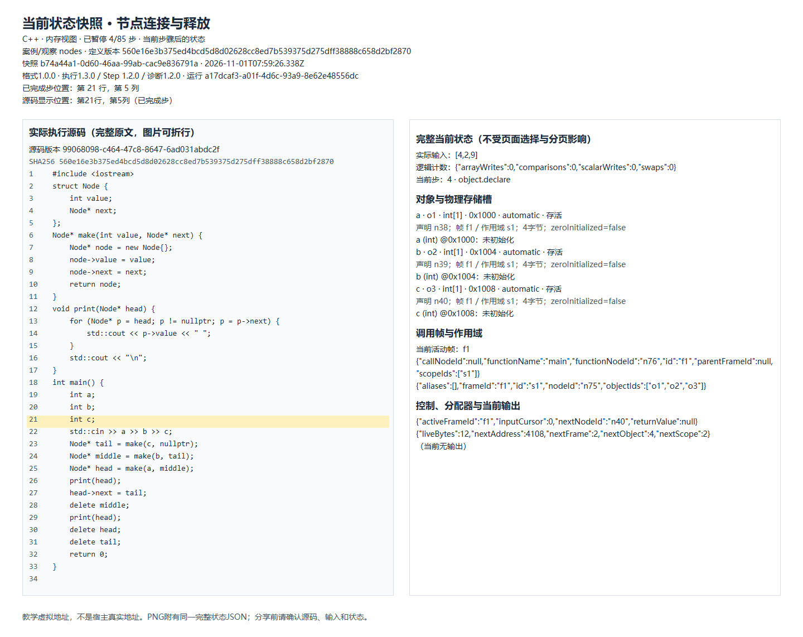
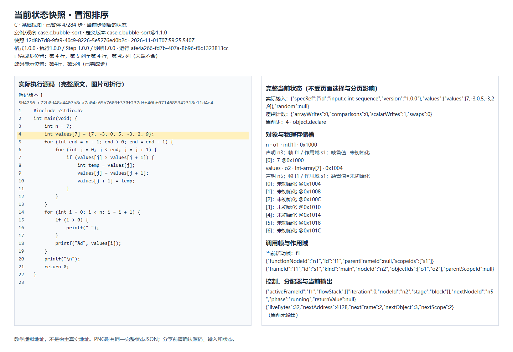

# 中文算法与内存 / C和C\+\+

导出时间：2026-11-01T07:59:26.871Z；预览时间：2026-11-01T07:59:26.775Z；档案时区：Asia/Shanghai。

本笔记仅包含显式选择的 2 条内容，不代表全部学习记录。

范围：章节 全部章节；日期 不限 至 不限；类型 快照。

快照是捕获时刻的完整状态副本；教学虚拟地址不是宿主真实地址。当前教材示例不是历史作答；未保存的作答源码不会在此补造。

本地图片与状态文件随压缩包提供。请完整解压，再用普通 Markdown 阅读器打开“笔记.md”。PNG也携带完整状态数据，分享前请核对。

## 1. 节点连接与释放

快照 · 2026-11-01 · C++

原时间：2026-11-01T07:59:26.338Z；时间语义：捕获时间。

捕获时刻 · 步骤 4/85 · 第 21 行，第 5 列

提示：捕获时刻的独立副本，后续运行不会更新此快照；教学虚拟地址不是宿主真实地址。

提示：没有可确认的当前课程章节，归入未关联内容。

原包：无精确引用；原内容：无精确引用；学习修订：不适用。

### 捕获快照 · C++

步骤：4/85；执行位置：第 21 行，第 5 列；高亮原因：executed\-step。

捕获时间：2026-11-01T07:59:26.338Z；快照标识：b74a44a1-0d60-46aa-99ab-cac9e836791a；源码版本：99068098\-c464\-47c8\-8647\-6ad031abdc2f；源码SHA-256：560e16e3b375ed4bcd5d8d02628cc8ed7b539375d275dff38888c658d2bf2870。

定义版本：\{"scheme":"source\-sha256","value":"560e16e3b375ed4bcd5d8d02628cc8ed7b539375d275dff38888c658d2bf2870"\}

运行语言、引擎及协议：

```json
{
  "domain": "p1-memory",
  "language": "cpp",
  "subset": null,
  "engine": {
    "buildId": "4f3cb075dc0b7da3a0afc9dd96f178b6a1b71184f125c726ddf0b81384f6b3a7",
    "id": "engine.rust.memory",
    "version": "0.1.0"
  },
  "identity": {
    "runId": "a17dcaf3-a01f-4d6c-93a9-8e62e48556dc",
    "sourceRevision": "99068098-c464-47c8-8647-6ad031abdc2f"
  },
  "versions": {
    "execution": "1.3.0",
    "step": "1.2.0",
    "diagnostic": "1.2.0",
    "integerEncoding": "1.0.0",
    "judge": null
  }
}
```

实际输入：

```json
[
  4,
  2,
  9
]
```

截至当前游标的输出：

```text

```

### 捕获源码

```cpp
#include <iostream>
struct Node {
    int value;
    Node* next;
};
Node* make(int value, Node* next) {
    Node* node = new Node{};
    node->value = value;
    node->next = next;
    return node;
}
void print(Node* head) {
    for (Node* p = head; p != nullptr; p = p->next) {
        std::cout << p->value << " ";
    }
    std::cout << "\n";
}
int main() {
    int a;
    int b;
    int c;
    std::cin >> a >> b >> c;
    Node* tail = make(c, nullptr);
    Node* middle = make(b, tail);
    Node* head = make(a, middle);
    print(head);
    head->next = tail;
    delete middle;
    print(head);
    delete head;
    delete tail;
    return 0;
}
```



[完整状态与映射（JSON）](snapshots/snapshot-01.json)

状态文件保留完整当前对象、调用栈、源码映射、游标和实际终止信息；没有整条轨迹。

## 2. 冒泡排序

快照 · 2026-11-01 · C

原时间：2026-11-01T07:59:25.540Z；时间语义：捕获时间。

捕获时刻 · 步骤 4/284 · 第 4 行，第 5 列至第 4 行，第 45 列（末端不含）

提示：捕获时刻的独立副本，后续运行不会更新此快照；教学虚拟地址不是宿主真实地址。

原包：content.c.p05@1.0.0；原内容：case.c.bubble\-sort@1.1.0；学习修订：不适用。

已核对的当前内容：case.c.bubble\-sort@1.1.0。

平台内来源路径（需在平台中打开）：/visualize/case.c.bubble\-sort

### 捕获快照 · C

步骤：4/284；执行位置：第 4 行，第 5 列至第 4 行，第 45 列（末端不含）；高亮原因：executed\-step。

捕获时间：2026-11-01T07:59:25.540Z；快照标识：12d8b7d8-9fa9-40c9-8226-5e5276ed0b2c；源码版本：1；源码SHA-256：c72b0d48a4407b8ca7a04c65b7603f370f237dff40bf0714685342318e11d4e4。

定义版本：\{"scheme":"content\-ref","value":"case.c.bubble\-sort@1.1.0"\}

运行语言、引擎及协议：

```json
{
  "domain": "p0-c",
  "language": {
    "id": "lang.c",
    "version": "1.0.0"
  },
  "subset": {
    "id": "subset.c.p0",
    "version": "1.0.0"
  },
  "engine": {
    "buildId": "aed203f4fe30ccaafdb32d0c68c2a1f2634c10726c82977684d4e3d20228679d",
    "id": "engine.c.p0",
    "version": "1.0.0"
  },
  "identity": {
    "contextId": "608604d0-f7bf-426b-b365-676687df51c6",
    "contextRevision": 1,
    "runId": "afe4a266-fd7b-407a-8b96-f6c1323813cc",
    "sourceRevision": 1,
    "submissionId": "e4342964-28bb-4029-84cc-7fd364bdec16",
    "testCaseKey": null
  },
  "versions": {
    "execution": "1.0.0",
    "step": "1.0.0",
    "diagnostic": "1.0.0",
    "integerEncoding": "1.0.0",
    "judge": "1.0.0"
  }
}
```

实际输入：

```json
{
  "specRef": {
    "id": "input.c.int-sequence",
    "version": "1.0.0"
  },
  "values": {
    "values": [
      7,
      -3,
      0,
      5,
      -3,
      2,
      9
    ]
  },
  "random": null
}
```

截至当前游标的输出：

```text

```

### 捕获源码

```c
#include <stdio.h>
int main(void) {
    int n = 7;
    int values[7] = {7, -3, 0, 5, -3, 2, 9};
    for (int end = n - 1; end > 0; end = end - 1) {
        for (int j = 0; j < end; j = j + 1) {
            if (values[j] > values[j + 1]) {
                int temp = values[j];
                values[j] = values[j + 1];
                values[j + 1] = temp;
            }
        }
    }
    for (int i = 0; i < n; i = i + 1) {
        if (i > 0) {
            printf(" ");
        }
        printf("%d", values[i]);
    }
    printf("\n");
    return 0;
}
```



[完整状态与映射（JSON）](snapshots/snapshot-02.json)

状态文件保留完整当前对象、调用栈、源码映射、游标和实际终止信息；没有整条轨迹。

