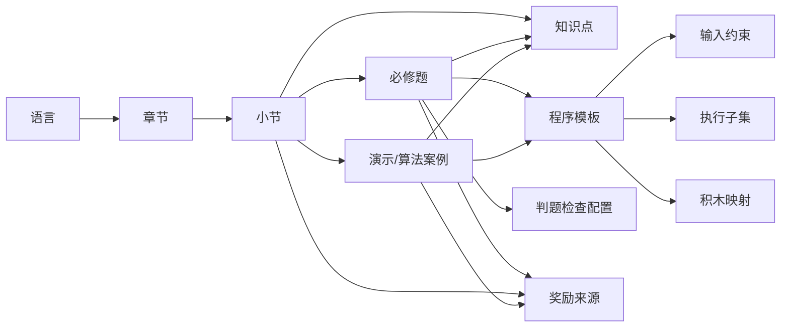

# 02.1 内容格式与引用契约

契约：**CONTENT-01 1.0.0**；日期：2026-10-14；负责人：Codex-02.1 主窗口。  
前置：[01.3 教学清单](../架构决策/01.3-课程积木与算法清单.md)、[P0-C](../架构决策/01.3-一期C子集支持矩阵.md)、[01.4 技术方案](../架构决策/01.4-技术版本与工程方案.md)、[预算](../架构决策/01.4-资源预算表.md)，均已文档验收。继承 REQ-BASE-01、DEC-001—004 V1.0。  
配套：[结构Schema](./02.1-内容结构.schema.json)、[内容样例](./02.1-内容样例.json)、[配置规则](./02.1-配置合法性规则.md)、[学习事件](./02.1-学习事件与奖励边界.md)。

## 1. 交付性质和版本

本任务冻结静态内容及学习领域的设计契约；JSON 是 **contract-fixture**，用于结构/引用/预期检查，不是正式课程、已实现的积木资产、真实 Rust 结果或轨迹。正式内容由09.1/08.4编写并真实验收，工程到03.1才建立。所有字段是公开静态配置，不含学习档案。使用UTF-8 JSON；对象键唯一，禁止注释/尾逗号/非有限数字。字段名用ASCII，教学文案允许中文。

| 版本维度 | 字段及固定规则 | 作用 |
|---|---|---|
| 内容结构契约 | `contractVersion: "1.0.0"` | 定义字段/语义；当前消费者仅接受精确1.0.0，不猜测兼容未知版本 |
| 公共内容包 | `packageId`、`packageVersion` | 一份不可变的、引用闭合的发布集合；样例为content.c.p0 / 1.0.0；不是存档版本 |
| 实体版本 | 每项`id`、`version` | 同ID同版本内容不可改写；修改必升版；同包每个ID仅一个版本，不自动取latest |
| 学习判定修订 | 小节/题目/案例`learningRevision`正整数 | 目标、必修关系、测试、结构判定或观看规则变化须递增；纯文案修订保持不变 |
| 旧学习兼容声明 | 上述实体`acceptedPriorVersions` | 只列同ID、同learningRevision且已经核对语义不变的旧版本；不使用范围、通配或“全部旧版” |
| 执行子集 | `subset.c.p0@1.0.0` | 对应P0-C V1.0；独立于内容/结构版本，不据新语言ID推断执行能力 |
| 判题检查配置 | `judgeProfiles`实体版本 | Rust消费有限检查类型与配置，结构/执行观测方式由02.2/09.3实现 |

版本字符串统一为三个无前导零的非负十进制段，当前均1.0.0。主版本表示不兼容改变，次版本表示显式登记的兼容增量，补丁表示语义不变的修订；**版本号本身不授权自动兼容**。所有跨实体引用都使用`{"id":"…","version":"1.0.0"}`并精确匹配。结构与发布版本未知、对象版本不符都拒绝新包；旧有效包可保留并明确显示旧包版本，不混装不同发布的条目。

历史通过/完成记录必须带实体ID、version及learningRevision。当前版本精确匹配或在acceptedPriorVersions中且learningRevision相同，才可用于当前小节完成；其他历史保留为旧版记录，不冒充新规则通过。迁移/存储事务由02.3制定。奖励范围不随文案版本或learningRevision自动更新，见学习事件契约。

## 2. 稳定ID和引用图

正式ID匹配`^[a-z][a-z0-9]*(\.[a-z0-9]+(?:-[a-z0-9]+)*)+$`，长度1—96；不含标题、序号位置、用户或日期，不随移动/重命名改变。全包ID唯一，删除后不重新用于不同对象。文档中的CH/EX/BLK/C等仍是历史定位符，以下映射正式采用，不能把旧定位符直接发送为正式ID。

| 旧定位符 | 正式ID（版本均1.0.0） |
|---|---|
| C / 后续C++、Java、Python | lang.c / lang.cpp / lang.java / lang.python |
| CH-01 / CH-02 / CH-03 | chapter.c.values / chapter.c.control / chapter.c.arrays |
| LESSON-01 / 02 / 03 | lesson.c.variables-output / lesson.c.expressions / lesson.c.conditions |
| LESSON-04 / 05 / 06 | lesson.c.loops / lesson.c.array-update / lesson.c.array-sum |
| EX-01 / 02 / 03 | exercise.c.echo / exercise.c.two-x-plus-three / exercise.c.nonnegative |
| EX-04 / 05 / 06 | exercise.c.two-loop-sums / exercise.c.increment-at-index / exercise.c.array-sum |
| DEMO-01 / 02 / 03 / 04 | case.c.assignment / case.c.branch / case.c.loops / case.c.array-traversal |
| ALG-01 / 02 / 03 | case.c.bubble-sort / case.c.selection-sort / case.c.binary-search-first |
| REF-01—10 | program.c.echo / two-x-plus-three / nonnegative / two-loop-sums / increment-at-index / array-sum / assignment / bubble-sort / selection-sort / binary-search-first（后九项同样带program.c.前缀） |
| BLK-01—10 | block.c.main / integer / declare-int / read-variable / assign-variable / unary / arithmetic / comparison / logical / if |
| BLK-11—20 | block.c.while / for / break / continue / declare-array / read-array / write-array / printf / return / scope |
| C-01—20 | subset.c.p0内局部能力键c.p0.01—c.p0.20；不是20个独立语言 |

知识点ID为knowledge.c.entry、variables、output、expressions、conditions、loops、arrays、input、sorting、binary-search（每项均带knowledge.c.前缀）。知识点`prerequisiteRefs`表达有向先修关系；必须无环、同语言。它是内容关系，不实现P1图谱点亮/解锁。语言间的对照关系待18.6增量，不假称可执行。

## 3. 包和实体字段

机器字段的精确必填/枚举/类型以配套Schema为准，关系和业务规则以本文及配置规则为准，三者共同生效。对象不允许未声明字段；新增字段须升契约版本并登记影响。Schema不负责跨实体查找、解析C或运行判题。

| 集合 | 主要字段与含义 |
|---|---|
| 包根 | contractVersion、packageId、packageVersion、purpose、phase、languages、subsets、chapters、lessons、knowledgePoints、inputSpecs、programs、judgeProfiles、exercises、cases、blocks、rewardSources；purpose只能contract-fixture或publishable |
| languages | id/version/title、execution（subset或reserved）、subsetRefs；C仅P0子集，三个后续语言reserved且subsetRefs为空，无章节/程序/积木执行引用 |
| subsets | id/version/title、languageRef、decision、capabilityIds；decision固定P0-C V1.0，20项能力按原矩阵解释 |
| chapters | id/version/title、languageRef、order、lessonRefs；order从1连续，同章顺序由lessonRefs数组决定 |
| lessons | id/version/title、languageRef、chapterRef、learningRevision、acceptedPriorVersions、knowledgeRefs、requiredExerciseRefs、optionalExerciseRefs、caseRefs、blockRefs、teaching、rewardRef；一期每节1必修题，完成规则固定主动确认+全部有效通过 |
| knowledgePoints | id/version/title、languageRef、prerequisiteRefs；不要把ID编码为页面地址 |
| inputSpecs | id/version/title、fields、relations；fields定义整数/序列的闭区间及长度；relations只接受length-of、index-in、nondecreasing，不接受脚本/公式字符串 |
| programs | id/version/title、languageRef、subsetRef、inputRef、exampleInput、sourceExample、bindings、blockRefs、reference；完整公开C实例+声明绑定元数据；sourceExample不是可直接改值执行的模板替代品 |
| judgeProfiles | id/version/title、rule、targetDescription；rule为本契约列明的6种检查，没有动态执行判题脚本 |
| exercises | id/version/title、languageRef、lessonRef、learningRevision、acceptedPriorVersions、knowledgeRefs、programRef、judgeRef、prompt、tests、rewardRef；每组测试含稳定caseKey、input、expectedStdout、expectedExitCode及可选expectedArray |
| cases | id/version/title、languageRef、kind（demo/algorithm）、learningRevision、acceptedPriorVersions、knowledgeRefs、relatedLessonRefs、programRef、teaching、resultRule、rewardRef；resultRule为已列枚举，仅定义Rust结果预期 |
| blocks | id/version/title、languageRef、subsetRef、connectionType、slotTypes、operators、capabilityIds；connectionType为program/statement/int-expression，明确外部连接产物；slotTypes列出该块涉及的内部槽/位置类别，不是外部连接许可；不配置P1锁定 |
| rewardSources | id/version/title、eventType、scope、repeat、pointsOwner；声明奖励来源，scope为content-id或local-day，repeat为first-only或once-per-day；分值由11.1冻结 |
| teaching | objectives、explanation、exampleProgramRefs、commonMistakes、boundaryNotes、source；以纯文本呈现，source含项目文档路径和定位符；不允许可执行HTML/脚本或随用户数据拼接的URL |

章节/小节/题目构成一对多归属；chapter.lessonRefs与lesson.chapterRef、lesson必修/选做题与exercise.lessonRef须双向一致。案例可关联多个小节，但relatedLessonRefs须与lesson.caseRefs互相一致。程序可由题目/演示共用；输入约束和判题规则可复用且必须精确引用。每个程序声明其生成会用的块，lesson.blockRefs覆盖本节题目所需块；案例代码可以使用课程介绍过的块而不设学习锁。

main仅为根program；字面量、变量/数组读取、一元/算术/比较/逻辑块输出int-expression；声明、赋值、控制、数组写入、printf、return及独立作用域均为statement，不能连接到值插槽。slotTypes中的int-expression对语句块表示接收表达式的内部槽，不把语句变为表达式。for-init/for-update按P0-C另限制可放的声明/赋值，不开放任意语句；10.1制定具体命名槽及连接检查，必须服从connectionType和原20类映射。

## 4. 输入与生成绑定

普通参数/序列元素闭区间-999..999，循环n为0..30，数组逻辑长度0..30，更新题1..30且0≤k<n。中间值/答案按int32，不按输入域限幅。input.fields的integer/sequence是参数类型，不表示C类型扩展；派生n不让用户重复填写。未知参数、缺参数、空白、非整数、域外或乱序均拒绝，不截断/填默认/静默排序。

bindings是固定声明目标的列表：`bindingKey`在程序中唯一；`inputKey`来自inputSpec（派生n允许）；`targetName`是示例中的C声明名；`targetKind`为scalar/array/logical-length；`from`为field/length-of；`emptyStorage`只对array设置one-zero-placeholder。绑定的真实节点/源码坐标由02.2/10.2制定。绑定到声明身份而非仅字符串名字或行号；同名遮蔽不能改绑。输入源对象被删、改名、重复或冒名引用必须拒绝提交；参数约束不等于P1积木解锁。

非空序列以常量容量N=n及规范十进制列表生成同一显示/执行代码；空序列必须显示`int n = 0; int values[1] = {0};`。array占位只为存储容量，逻辑视图/案例仍为空；空输入读取values[0]不谎报C越界，但不满足逻辑输入约定。n不得被用户解答写入；源标量x/k、源数组保护的是声明身份/名称和输入初始化，不是把标量设为运行时只读，x的后续赋值仍可用于DEMO-01及满足本题目标的等价解。数组元素可按题目修改。检查源绑定和初始化的真实身份/一致性由Rust判定适配落实，不靠前端扫描源码文本。

每组测试从同一提交的解答结构生成对应完整源码/源码版本、真实输入和绑定映射；与展示/复盘的该组实例相同，禁止Worker隐藏改值。转换输入只从校验后的数值生成，不能把原始文本插入源码。新输入/积木编辑立即使当前旧运行/判定失效；保存的历史通过仍标历史版本。源码坐标、run/source/submission身份和结果字段留02.2，不在此定义第二套执行消息。

随机生成返回**已校验实际输入**，与手动共用inputSpec；须保留生成算法标识/版本与seed以便临时复现，精确算法及seed格式由07.2与02.4冻结，当前JSON不伪造已定seed协议。二分随机模式生成非递减数组，手动模式乱序明确拒绝。引擎源码/内存/步数预算仍遵守DEC-004，不能把课程30项当作所有C数组的语法上限。

## 5. 判题配置与算法规则

六题均为blocks-execution，全部冻结测试组由同一Rust环境正常结束、main返回0、stdout逐字节相等、源绑定合法、所需教学检查通过，才可发通过事件。expectedStdout中的JSON `\n`解码成实际换行；不trim、不忽略多余输出。不按参考源码文本相等判定，不以播放器终点判通过。

| judge.rule | 业务要求；检查来源为AST及真实运行观测 |
|---|---|
| input-read-output | EX-01声明/真实读取x并输出；禁止打印常量冒充 |
| multiply-add-output | EX-02实际执行相关乘法与加法并依赖x，允许同范围等价表达顺序 |
| if-else-paths | EX-03必须if/else，整个测试组实际覆盖两路；不能只打印关系表达式 |
| while-for-accumulations | EX-04 while/for为两个必过子目标；正n两者实际迭代，各输出分别来自其循环中的有效累加，n=0两路0；装饰循环+闭式公式不满足 |
| single-index-increment | EX-05真实数组读写；在main返回/目标作用域销毁前观测仅values[k]+1，其余逻辑元素不变，stdout为改后值；不能假定终态仍有数组 |
| logical-array-accumulation | EX-06实际循环遍历[0,n)并累加到输出，空输入无读取；不能把占位0计为数据 |

检查类型定义业务目标，并未提供通用程序证明器。具体AST节点关联、动态数据依赖/累计观测、失败分类和证据编码由02.2/09.3冻结/实现；不能在前端另写C解析/算法。样例的24组测试完整继承01.3；后续可在版本变更流程中增加验证，不悄悄删测试。

案例resultRule：assignment-add-two、nonnegative-branch、two-loop-sums、logical-array-sum、bubble-ascending、selection-ascending、binary-first-index。前三排序/搜索约束遵守01.3固定方案：冒泡相邻严格大于才换、缩小尾部、无提前退出；选择同值留首个最小下标且非自交换，不承诺稳定；二分非递减、闭区间、中点left+(right-left)/2、命中继续向左，首个0基下标/-1。排序stdout单空格无尾空格+换行，空只换行；搜索索引+换行。前端只消费Rust真实结果/轨迹，resultRule不是前端算法授权。

## 6. 后续责任

| 任务 | 输入/责任 |
|---|---|
| 02.2 | 复用本契约实体Ref及学习判题修订，定运行/源码/提交身份、输入绑定节点/判题观测/诊断/Step DSL及预算编码；不改内容ID语义 |
| 02.3 | 复用学习事件、兼容版本和奖励来源；定存档/日期/幂等键/事务/多标签/迁移，不持久化原始运行内容 |
| 02.4 | 整合本内容样例及02.2/02.3机器夹具，建立共享版本/影响/双方验证流程；本文只定当前契约精确接受规则 |
| 03.3、09.1 | 将Schema+关系规则落成发布/加载验证；正式课程文案/来源和积木资产进入publishable包前完整审核 |
| 08.4、09.3、10.2、11.1 | 分别真实案例/判题/生成和奖励实现；契约样例不记作产品验收证据 |

目前新增语言仅保留lang.cpp/java/python标识，不增加执行子集、课程、空页面或语言积木生成能力；P1/P2内容以现有稳定引用和升版方式扩展，不提前添加账号、云档案或管理后台。
