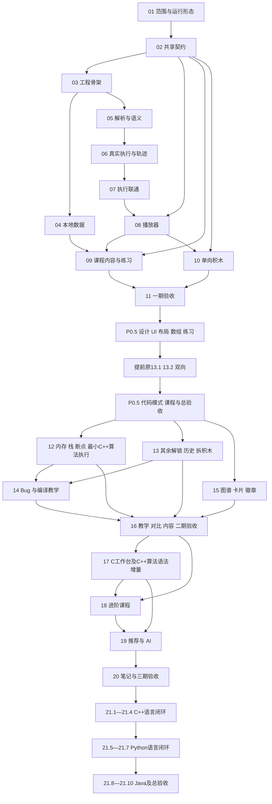

# 开发路线与依赖

依据：[项目守则](../项目守则.md)。本文件是工作顺序，不是已完成清单。任务实时状态统一见[进度与交接](./任务进度与交接.md)。

2026-10-30当前排期：P0.5有效任务9/9、第12部分及第13部分各五项全部验收，原51/88、主路线51/98。正式1.0.20（101源）在原20块/8章32节32题140组/七C案例上增加六道拆积木模式，共用原题身份/首次积分，保留13.3权限与13.4的100条/8 MiB历史、SAVE3/DB3/12store。见[13.5验收](./验收/13.5-拆积木练习验收.md)与[交接](./交接/13.5-交接.md)。下一最早14.1未领取；第16及第21通用语言闭环未实施，21仍0/10。后续默认仅验Chrome及一种代表主题。

2026-10-29追加排期：第20步后新增[第21步](./任务包/第21步-依次扩展C++、Python与Java语言支持.md)，依次完成C++→Python→Java，共10项，当前0/10，P0.5保持9/9。已有C继续用C；新算法可视化/演示代码以C++为基准，复杂算法只提供C++版。12/17先实现16/18所需最小真实C++执行，第21步再完成通用语言学习闭环，详见[决议](./架构决策/2026-10-29-多语言排期与C++算法基准决议.md)。规划当时原43/88，12.1实施后的当前统计以上段为准，不将最小子集记作21完成。

## 一、第一步到第二十一步

| 步骤 | 阶段 | 任务包 | 子任务数 | 前置与开工条件 |
|---|---|---|---:|---|
| 第01步 | P0 | [冻结需求范围与实施决策](./任务包/第01步-冻结需求范围与实施决策.md) | 4 | 无；本步骤先完成，再进入产品实现。 |
| 第02步 | P0 | [制定共享契约与标准样例](./任务包/第02步-制定共享契约与标准样例.md) | 4 | 01.1—01.4 已验收。 |
| 第03步 | P0 | [建立工程骨架与页面框架](./任务包/第03步-建立工程骨架与页面框架.md) | 4 | 第二步验收通过；这是最早允许建立产品工程的步骤。 |
| 第04步 | P0 | [完成浏览器本地数据基础](./任务包/第04步-完成浏览器本地数据基础.md) | 3 | 02.3、03.1；可与第五步并行。 |
| 第05步 | P0 | [实现 C 子集解析与语义检查](<./任务包/第05步-实现 C 子集解析与语义检查.md>) | 3 | 01.3、02.2、02.4、03.3；与第四步独立。 |
| 第06步 | P0 | [实现受限执行与真实轨迹](./任务包/第06步-实现受限执行与真实轨迹.md) | 4 | 第五步验收；02.2 契约冻结。 |
| 第07步 | P0 | [打通真实执行与数据输入](./任务包/第07步-打通真实执行与数据输入.md) | 3 | 03.4、06.4；最终执行链路的第一道集成门槛。 |
| 第08步 | P0 | [实现播放器与基础可视化](./任务包/第08步-实现播放器与基础可视化.md) | 4 | 02.2、03.2 后可用标准样例开发；完成验收还依赖 07.3。 |
| 第09步 | P0 | [完成课程与基础练习闭环](./任务包/第09步-完成课程与基础练习闭环.md) | 4 | 02.1 后可先整理内容；完整验收依赖 04.3、08.4，积木练习依赖 10.3。 |
| 第10步 | P0 | [完成积木到 C 的单向编程](<./任务包/第10步-完成积木到 C 的单向编程.md>) | 3 | 01.3、02.1、02.2、03.2 后可并行开发；完成验收依赖 08.4。 |
| 第11步 | P0 | [接入基础激励并验收一期](./任务包/第11步-接入基础激励并验收一期.md) | 5 | 04.3、08.4、09.4、10.3；一期验收覆盖第一至十一步全部必需任务。 |
| 1.5期插入 | P0.5 | [体验改进与基础教学补强](./任务包/P0.5-体验改进与基础教学补强.md) | 新增9项 | 11.5；03已删除、其他编号不变；UI/宽工作台优先，原13.1/13.2提前融入且不重复计数，P0.5-10总验收。 |
| 第12步 | P1 | [扩展执行语义及内存调用栈调试](./任务包/第12步-扩展执行语义及内存调用栈调试.md) | 5 | 11.5、P0.5-10；先更新兼容契约；12.1/12.2补新算法最小C++真实执行，保留C能力。 |
| 第13步 | P1（部分前移） | [完善积木双向联动与学习约束](./任务包/第13步-完善积木双向联动与学习约束.md) | 5 | 13.1/13.2按P0.5任务包提前；13.3—13.5等P0.5-10及各自前置。 |
| 第14步 | P1 | [实现诊断教学、编译流程与 Bug 闯关](<./任务包/第14步-实现诊断教学、编译流程与 Bug 闯关.md>) | 4 | 11.5、P0.5-10；指针关卡依赖12.2，定位积木依赖13.2。 |
| 第15步 | P1 | [建立知识图谱、复习卡片与徽章](./任务包/第15步-建立知识图谱、复习卡片与徽章.md) | 4 | 11.5、P0.5-10；徽章的递归/指针条件依赖12.4、14.4。 |
| 第16步 | P1 | [完善教学交互、算法目录并验收二期](./任务包/第16步-完善教学交互、算法目录并验收二期.md) | 10 | 11.5、P0.5-10；各子任务分别依赖第十二至十五步能力，二期门槛覆盖全部。 |
| 第17步 | P2 | [建设受支持子集的自定义代码工作台](./任务包/第17步-建设受支持子集的自定义代码工作台.md) | 4 | 16.10；原C工作台保持，17.1/17.2补18所需C++语法增量；通用C++入口留21。 |
| 第18步 | P2 | [建设进阶算法课程、多解法与语言对照](./任务包/第18步-建设进阶算法课程、多解法与语言对照.md) | 6 | 16.10；新增例题/算法/解法为C++，新语法依赖17.2；18.6仅内容对照。 |
| 第19步 | P2 | [实现薄弱点出题与 AI 可视化调试](<./任务包/第19步-实现薄弱点出题与 AI 可视化调试.md>) | 5 | 17.4、18.3；错题/卡片能力来自第十五步。 |
| 第20步 | P2 | [完成笔记导出与三期交付](./任务包/第20步-完成笔记导出与三期交付.md) | 4 | 17.4、18.1—18.6、19.5；笔记设计可提前从 16.3 开始。 |
| 第21步 | 后续多语言 | [依次扩展C++、Python与Java语言支持](./任务包/第21步-依次扩展C++、Python与Java语言支持.md) | 10 | 20.4；21.1—21.4先C++，通过后21.5—21.7 Python，再21.8—21.10 Java及总验收。 |

## 二、建议按以下顺序推进

1. **先定规则，再开工程**：完成第 01 步的范围、运行形态、C 子集、版本与指标；完成第 02 步的内容/轨迹/存档契约。
2. **先跑真实程序，再扩页面**：第 03 步建立工程。第 04 步本地状态与第 05—06 步解释器可并行；第 07 步先用少量案例验证真实执行。
3. **组成一期教学闭环**：播放器、课程内容、积木可按稳定契约并行，分别在第 08—10 步联调。第 11 步接入激励并完成一期验收。
4. **先做1.5期体验改进**：按P0.5任务包完成设计/主题/宽布局，再数组/积木/练习、提前的13.1/13.2、代码模式与课程；P0.5-10过后再做二期主体。其余二期执行扩展、多视图、知识成长按依赖并行；Bug闯关等定位和安全指针语义，第16步整合验收。
5. **最后开放进阶能力**：第 17 步开放受支持代码；第 18 步完成进阶课程/目录；第 19 步做可验证推荐与真实 AI；第 20 步导出与全量交付。
6. **再依次扩展语言**：第21步在20.4之后完成C++、Python、Java的受支持语言闭环，各有真实执行、课程/练习、积木/工作台和验收；前一语言门槛通过后再开始后一语言。16/18的新算法先使用12/17已验的最小C++能力，避免回依赖21。

## 三、关键依赖示意

示意图按步骤合并了依赖；准确开工条件以子任务卡为准。例如 09.1 可先编写课程，09.4 必须等 10.3；15.4 徽章必须等指针关卡；18.4/18.5 必须等三期解释器能力。不能仅依据图中未画出的边就认定无依赖。

## 四、适合不同窗口的并行组合

| 条件 | 窗口 A | 窗口 B | 窗口 C | 协调重点 |
|---|---|---|---|---|
| 03.4 已验收 | 04 本地存储 | 05→06 Rust | 09.1 课程内容 | 存档/内容契约不各自改名 |
| 契约稳定、工程可用 | 08 播放器标准样例 | 10 积木生成 | 09 内容/练习准备 | 最终都接真实轨迹；样例不算完成 |
| 一期通过、P0.5进行中 | P0.5主题/布局按单写者串行 | 课程原创准备/来源审校 | 非共享文件的交互复现 | 先按P0.5依赖与文件归属，原13.1/13.2在基础UI后提前融合 |
| P0.5通过 | 12 执行与多视图 | 13其余任务 | 15.1—15.3 图谱/卡片 | 已验双向复用，不重复实现；徽章等待必要事件 |
| 二期能力稳定 | 14 关卡与诊断 | 16 交互与案例 | 二期内容校验 | 解释器增量先合入，避免各做执行逻辑 |
| 二期通过 | 17 自定义代码 | 18.1—18.3 课程 | 20.1 笔记设计 | 新语法案例等 17.2；AI 等真实轨迹 |
| 三期轨迹可用 | 19 推荐/AI | 18 目录补齐 | 20 导出 | 共用来源、上下文和数据边界 |
| 20.4通过且21.1冻结 | 当前语言解释执行 | 当前语言课程/积木准备 | 旧语言兼容审查 | 先C++、再Python、再Java；同语言内按具体前置并行，不提前开启下一语言 |

并行是可选安排，**同一文件不能由多个窗口同时修改**。共享工程文件和总台账由协调窗口管理。一个人使用多个窗口时，保留一个协调窗口最方便；其余窗口只领取已分配子任务。

## 五、阶段门槛

- **一期门槛 11.5**：新浏览器状态走通课程/积木/执行/可视化/练习/本地奖励，刷新恢复；解释器、资源限制、输入与完整播放控制真实可用。
- **1.5期门槛 P0.5-10**：16条有效体验需求有证据，REQ-P05-04有取消依据；至少6套完整主题及积木皮肤、主题预览/保存和明暗、宽工作台/长数组、真实拖拽、空白练习与代码/积木两模式、32节32题及旧数据兼容通过。背景保持纯色或柔和渐变，不要求已取消的图片导入或已移除的自选色前台入口；提前的原13.1/13.2按原验收通过。
- **二期门槛 16.10**：全部 P1 能力与二期案例有证据，多视图/断点/回退/双算法组合可用，旧存档不丢失；新增16.4—16.9为真实C++，已有C案例保持。
- **三期门槛 20.4**：原文明列算法覆盖，自定义代码/多解法/薄弱点/真实 AI/笔记可用；新增进阶算法使用真实C++，18.6仅静态对照，不要求提前完成21。
- **多语言门槛21.4/21.7/21.10**：依次验收C++、Python、Java的语言闭环与最终兼容；复杂算法仍只C++。没有通过前一语言门槛，不启动后一语言实现。

阶段门槛未过，不把后续依赖任务标成已验收。未依赖前置能力的内容整理和设计可以提前进行。

## 六、仍只预留的远期扩展

原LANG-01（C++）、LANG-03（Python）、LANG-02（Java）方向已依用户顺序转入第21步正式任务，不再只记远期方向；保留旧LANG编号的历史含义，不按新顺序重分配。内容对照和真实执行仍分别验收。

| 编号 | 后续方向 | 真正启动前要补的决策 |
|---|---|---|
| FUT-01 | 账号和云存档 | 身份、同步冲突、数据边界与本地迁移 |
| FUT-02 | 排行榜 | 依赖账号与可信积分，不能直接上传可修改的本地账本 |
| FUT-03 | 多人协同房间 | 协同状态、会话、权限与同步方式 |

以上FUT项只登记方向，不创建实现任务；新增第21步不改变账号、云存档、排行榜和多人协作的排除边界。
