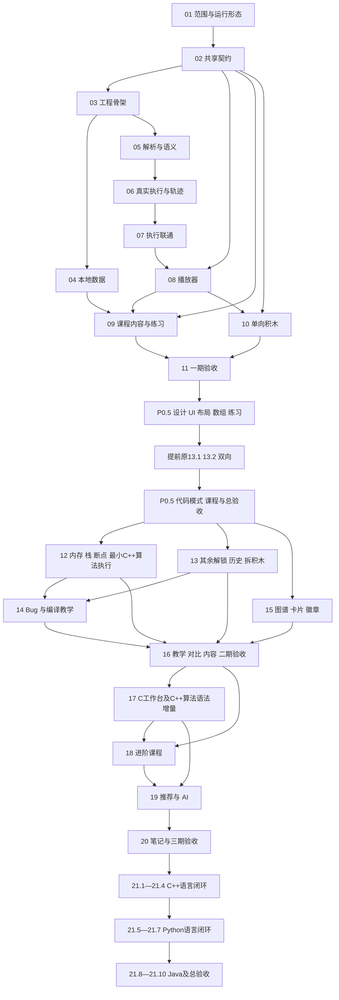

# 开发路线与依赖

第18整块质量复核通过（2026-11-01）：历史case-set活动QA已适配DB8完整16store及全部步骤/精确七C入口；9个test完整覆盖42原输入、7组全原子正逆/42组六速暂停继续、4非法拒绝/1真实恢复和7目录链接，原生全档案前后相等。本轮类型/lint/格式通过；59/394源与四WASM不变，按实SHA继承18.6的2057全量、241正式Chrome及完整构建，旧2015 QA/16外窗CI保持。见[整块验收](./验收/18-整块质量复核.md)、[机器证据](./验收/18-整块质量最终复核.json)及[独立交接](./交接/18-整块质量-交接.md)。原79/88余9、主79/98、P2 10/19、18子项6/6、P0.5 9/9、21为0/10不变；整块QA债务已消除，§8.1 Git待协调另派，本轮无暂存/提交/推送，不进19/21。下方六项记录保留历史时点。

18.6实际验收（2026-11-01）：静态C→C++→Python→Java迁移已交付，六主题/24原创片段/72预写标注、12对照与已有语言实际变化、播放/暂停/重置/切换失效、旧基础与复习入口齐备，非新语言执行或学习授权。正式59/394源（53—58保留），2057全量单worker前端、241正式Chrome及类型/lint/格式/完整构建通过；三宽Inspector0FAIL/0WARN。见[验收](./验收/18.6-静态语言迁移验收.md)、[独立交接](./交接/18.6-交接.md)、[使用说明](./交付/18.6-语言迁移使用说明.md)。原79/88、余9，主路线79/98、P2 10/19、第18子项6/6、P0.5 9/9、21为0/10；算法22/22与26案例7C/19CPP不增。旧QA/16外窗CI、四WASM/预算/SAVE8保持。第18整块QA债务维护/全18复核/§8.1 Git待协调另派，19未领取；本轮无暂存/提交/推送，下方保留历史时点。

18.5实际验收（2026-11-01）：KMP真实C++前缀表/首次匹配与双行ASCII输入已交付，24公开样例/225短串独立预期/逐级回退/全原子逆向、讲解/复杂度/边界/原基础复习齐备。正式58/386源（53—57保留），2033全量单worker前端、208正式Chrome及类型/lint/格式/完整构建通过；三宽Inspector0FAIL/0WARN。见[验收](./验收/18.5-KMP内容与真实匹配验收.md)、[独立交接](./交接/18.5-交接.md)、[使用说明](./交付/18.5-KMP使用说明.md)。原78/88、余10，主路线78/98、P2 9/19、第18为5/6、P0.5 9/9、21为0/10；算法22/22、正式26案例（7C/19CPP），经典三例六方案另列。18.6未领取，交协调同聊天派发；第18整块未完成。四WASM/预算/SAVE8/旧身份及16外窗CI、167/185/435/650旧QA原件保持，无暂存/提交/推送；下方保留历史时点。

18.4实际验收（2026-11-01）：埃氏筛、欧拉筛、最大连续子序列和与严格LIS四个真实C++案例已交付，44公开样例/全原子逆向、全部筛上界/短序列独立预期、讲解/复杂度/边界/原基础复习齐备。正式57/374源（53—56保留），1988全量单worker前端、174正式Chrome及类型/lint/格式/完整构建通过；四页三宽Inspector0FAIL/0WARN。见[验收](./验收/18.4-筛法与序列验收.md)、[独立交接](./交接/18.4-交接.md)、[使用说明](./交付/18.4-筛法与序列使用说明.md)。原77/88、主路线77/98、P2 8/19、第18为4/6、P0.5 9/9、21为0/10；算法21/22、正式25案例（7C/18CPP），经典三例六方案另列。18.5未领取，交协调同聊天派发。无新增学习授权/SAVE，四WASM/预算/旧身份及16份外窗CI、167/185/435旧QA原件保持，无暂存/提交/推送；下方保留历史时点。

18.3实际验收（2026-11-01）：三题各两份真实C++方案与同输入对比已交付，28组/56实际执行及全原子逆向、复杂度/空间/边界/适用场景、单槽共用1000ms/失效/取消/恢复齐备。正式56/359源（55保留），1938全量单worker前端、113唯一正式Chrome及类型/lint/格式/完整构建通过；三页三宽Inspector0FAIL/0WARN。见[验收](./验收/18.3-同题多解法与对比验收.md)、[独立交接](./交接/18.3-交接.md)、[使用说明](./交付/18.3-同题两解使用说明.md)。原76/88、主路线76/98、P2 7/19、第18为3/6、P0.5 9/9、21为0/10；18.4未领取，交协调同聊天派发。无新增学习完成/奖励/SAVE，四WASM/预算/旧身份及16份外窗CI、18.1/18.2原件保持；无暂存/提交/推送。下方旧记录保留历史时点。

18.2实际验收（2026-11-01）：首批两数之和、移动零、搜索插入位置三例已交付，官方来源/原始约束/平台裁剪与原创解析齐备，每例一份真实C++方案，19公开输入由advanced Rust/WASM执行及全原子回退。正式54/347源，1898全量前端、42唯一正式Chrome、类型/lint/格式/完整构建、两页三宽Inspector0FAIL/0WARN通过；旧学习/六课升级/C工作台回归通过。见[验收](./验收/18.2-经典例题与来源验收.md)、[独立交接](./交接/18.2-交接.md)、[使用说明](./交付/18.2-经典例题使用说明.md)。原75/88、主路线75/98、P2 6/19、第18为2/6、P0.5 9/9、21为0/10；18.3未领取，交协调在本聊天派发。仅教学演示无新增完成/奖励/存档，SAVE8/DB8/16store、旧内容身份、四引擎/预算保持；18.1全部167份QA及16份外窗CI资料字节保护。本轮无暂存/提交/推送；下方旧记录保留历史时点。

18.1实际验收（2026-11-01）：进阶课程2章4节编排已交付，共用原C小节/必修题/知识点与持久进度，连接四个已验真实C++排序案例。正式53/336源，1874全量前端、15唯一正式Chrome、类型/lint/格式/完整构建及两页三宽Inspector0FAIL/0WARN通过；旧档/失败恢复/奖励防重及原复习队列已验。见[验收](./验收/18.1-进阶课程与记录复用验收.md)、[独立交接](./交接/18.1-交接.md)及[使用说明](./交付/18.1-进阶课程使用说明.md)。原74/88、主路线74/98、P2 5/19、第18为1/6、P0.5 9/9、21为0/10；18.2未领取，待协调派发。SAVE8/DB8/16store、四引擎/预算及旧内容身份保持，16份外窗CI资料原字节保护。本轮无暂存/提交/推送；下方旧截止与计数保留历史时点。

第17整块Git交付（2026-11-01）：产品[完成17部分](https://github.com/Getaway-Wuji/programming-visualization-learning/commit/9010778110e0942c63864be0b61958f1b7a7d0fa)已推送私有main，作者与提交者均实查归属Getaway-Wuji，本地/远端SHA一致。[Actions 41217615764](https://github.com/Getaway-Wuji/programming-visualization-learning/actions/runs/41217615764)已真实通过归档、固定环境构建、类型与lint。417文件/37发布索引/299凭据/207份冻结QA已逐暂存blob与SHA核对；继承已验UI前置，其他窗口16份CI资料原字节保护且未夹带。正式52/329源及543 Rust/1868前端/55唯一Chrome、原73/88/主73/98保持。见[Git交接](./交接/17-Git交付-交接.md)及[实际证据](./验收/17-Git交付/实际交付.json)。本条与必要交接为推送后文档记录，最终记录SHA在聊天返回；第17交付后停止，18/21未领取。下方旧记录为历史时点。

17.4实际验收（2026-10-31）：真实C工作台深嵌套/无限循环/递归/非法指针/超量输出、取消与重复请求、纯文本及无持久执行日志、故障后恢复通过；严格Rust检查的两处等价条件已整理，追加正式52/329来源，旧48—51原件保留。最终1868前端、543 Rust/原忽略1、55唯一正式Chrome（35工作台+14进阶+6旧路）、类型/lint/格式/构建与双目标严格Clippy通过；84份原件留存。见[验收](./验收/17.4-工作台对抗与恢复验收.md)、[独立交接](./交接/17.4-交接.md)。第17四项全部验收，原73/88、主路线73/98、P2 4/19、P0.5 9/9、21为0/10；18.1可领取但未开始。root按既有整块授权进入归属/暂存审计，远端Git结果另追加；其他窗口CI资料保持。下方旧记录保留历史时点。

17.3实际验收（2026-10-31）：C代码工作台已接入真实advanced Rust/WASM，含原文编辑/整数输入、取消、定位、行断点、回退与同游标三视图；SAVE8/DB8/16store提供显式单份C源码草稿、CAS/失败保稿/清除屏障，原输入/轨迹不保存。正式51/329来源（50保留），最后源码1865全量、51正式18唯一Chrome（新12/旧6）、DB1—7原生升级、类型/lint/格式/构建及旧引擎SHA通过。见[验收](./验收/17.3-C工作台验收.md)、[交接](./交接/17.3-交接.md)及[使用说明](./交付/17.3-C代码工作台使用说明.md)。原72/88、主路线72/98，P0.5 9/9、21为0/10；17.4未领取，第17整块未完成。继承UI/CI与17.1/17.2成果保护，无暂存/提交/推送。下方旧记录保留历史时点。

17.2实际验收（2026-10-31）：C受限scanf与C++有界ASCII字符串已由独立advanced Rust/WASM真实执行；筛法/序列/KMP开发样例、改码/不同输入、原子全逆、取消恢复及旧版兼容通过。全量537 Rust/原忽略1、1859前端，后补advanced31项/接收5项；34唯一Chrome（新14+旧20）、36真实包Schema及类型/lint/格式/构建通过，旧源码/WASM SHA保持。见[实现决议](./架构决策/17.2-独立进阶执行与字符串布局.md)、[验收](./验收/17.2-解释器增量验收.md)与[交接](./交接/17.2-交接.md)。原71/88、主路线71/98，P0.5 9/9、21为0/10；17.3未领取，第17整块未完成。新工作台UI仍属17.3；原UI/CI成果保护，无暂存/提交/推送。下方旧时点说明保留历史含义。

第16整块Git交付（2026-10-31）：已按既有授权推送[完成16部分](https://github.com/Getaway-Wuji/programming-visualization-learning/commit/ddb2410f2a2202f36c279a836f4dcbd4109766fb)，接在原CI提交08aae414之后，无改写历史；本人作者/提交者Getaway-Wuji及仓库私有已实查。长路径兼容追加[143d499b4971084206d310ee30ea8a039e339321](https://github.com/Getaway-Wuji/programming-visualization-learning/commit/143d499b4971084206d310ee30ea8a039e339321)后的[Actions 41198994220](https://github.com/Getaway-Wuji/programming-visualization-learning/actions/runs/41198994220)实际通过归档32索引/284凭据、构建、类型与lint；16.10正式47/299、1841前端、281浏览器及本地参考性能原验收保留，68个500ms整组和37个800/600整组偏差不改判。原69/88、主路线69/98、P1 28/28、P0.5 9/9、21为0/10。交付记录本身另作必要文档提交，实际最终SHA随聊天结果返回；外窗补充资料保留且未夹带。第16已交付后立即停止，17.1未领取，等待用户明确开始17。 见[独立Git交接](./交接/16-Git交付-交接.md)与[实证](./验收/16-Git交付/实际交付.json)。下方提交前及旧时点资料保留历史含义。

16.10当前验收（2026-10-31）：正式47/299源，1841全量、281唯一正式Chrome、参考主机110导航/120完整事务及三段30秒播放通过；独立产品源构建/旧原件归属检查齐备。原500ms整组偏差68/120、800/600整组偏差37/120保留，单执行/连续分段满足既有容差且复合组在原1000ms内；不冒称全面500ms或物理60fps。32节40题172组20块、7C/14CPP、22算法17已验5后续、SAVE7/DB7/15store保持。原69/88、主路线69/98、P1 28/28、P0.5 9/9、21为0/10。见[二期验收](./验收/16.10-二期整体验收.md)、[交接](./交接/16.10-交接.md)、[运行说明](./交付/16.10-二期运行与本地数据说明.md)和[最终复核](./验收/16.10-最终复核.json)。先交协调实际核验，再由协调另派本聊天第16整块Git收尾；之后立即停止，17.1未领取、等待用户明确启动，不自动进入17/21。外窗CI修改/新增归档另列保留；本轮未暂存/提交/推送，未动真实用户资料。下方旧时点叙述保留历史含义。

16.9历史验收（2026-10-31）：四个真实C++经典案例已验收：汉诺塔0..5真实位置数组/别名与最多7帧；GCD±999双零约定0；朴素素数低于2否；回文负否且三位反转有界。固定1/2输入、显示原文直接执行，数值/图/原内存/栈同游标与全原子回退。正式1.0.44（298源），105相关单元、60唯一正式Chrome、29种正式case/input原包独立复核；四页三宽Inspector0FAIL/0WARN，源UI lint0FAIL/1原课程编号WARN，类型/ESLint/格式/正式构建/自有dev与preview通过。SAVE7/DB7/15store、32节40题172组20块、七C/既有十CPP/两对比及三Rust/WASM/协议/原预算保持，无新学习奖励/经典挑战/对比/快照。原68/88、主路线68/98、P1 27/28、P0.5 9/9、第21步0/10；16.10未领取，第16整块未完成。见[验收](./验收/16.9-C++经典问题验收.md)、[使用说明](./交付/16.9-C++经典问题使用说明.md)、[交接](./交接/16.9-交接.md)、[算法覆盖表](./算法目录覆盖表.md)、[44凭据](./验收/发布凭据/16.9-1.0.44/index.json)、[验证原件](./验收/16.9-验证原件/index.json)及[最终复核](./验收/16.9-最终复核.json)。22算法中17已验/5留18.4/18.5，四C语法演示另列，合计21正式案例。6567基线文件无删除、3723旧原件/24既有本地ZIP/外窗CI交接SHA保持，不修CI；无Git写入/代理/新聊天/工作树/自动化/真实用户清档，HEAD ec023619，空暂存/待推送链0。下方旧时点记录保留历史含义。

16.8历史验收（2026-10-31）：16.8真实C++单链表与BST已验收：各容量7，位置插删/遍历与拒重插入/查找/三遍历，真实Node*/new/delete、待链接/断链/墓碑及全原子回退；图形/原内存/栈同游标。正式1.0.43（283源），86相关单元、45唯一正式Chrome、23正式原包（22种case/input）独立结构/全逆复核；两页三宽Inspector0FAIL/0WARN，源UI lint0FAIL/1原编号WARN已说明，类型/格式/ESLint/正式构建/自有dev与preview通过。SAVE7/DB7/15store、32节40题172组20块、七C/六CPP排序/两栈队列/两对比、三Rust/WASM/协议和原预算保持；无新学习奖励/节点挑战/对比/快照。原67/88、主路线67/98、P1 26/28、P0.5 9/9、第21步0/10；16.9未领取，第16整块未完成。 见[独立验收](./验收/16.8-C++链表与BST验收.md)、[使用说明](./交付/16.8-C++链表与BST使用说明.md)、[交接](./交接/16.8-交接.md)、[43凭据](./验收/发布凭据/16.8-1.0.43/index.json)与[验证原件](./验收/16.8-验证原件/index.json)。6138开工文件按归属保护、无删除，35—42及全部旧原件/外窗CI交接保持。不修CI、无Git写入/代理/新聊天/工作树/自动化/真实用户清档；HEAD ec023619，空暂存/待推送链0。下方旧时点记录保留历史含义。

16.7历史验收（2026-10-31）：16.7真实C++数组栈/环形队列已验收：容量5、单调head/tail取模及真实top，逐行入整数/出编码总≤30槽、−999..999，空满拒绝/残值/未发布/同值写/生命周期完整回退。正式1.0.42（270源），99相关单元、35唯一正式Chrome、16组正式原包独立全逆复核；两页三宽Inspector0FAIL/0WARN，源UI lint0FAIL/1项原课程编号WARN已说明，类型/格式/ESLint/正式构建/自有dev与preview通过。SAVE7/DB7/15store、32节/40题172组/20块、七C/六CPP排序/两对比、三Rust/WASM及原协议/预算保持；无学习奖励/结构挑战/对比/快照。原66/88、主路线66/98，P1 25/28、P0.5 9/9、第21步0/10；16.8未领取，第16整块未完成。 见[独立验收](./验收/16.7-C++栈与队列验收.md)、[使用说明](./交付/16.7-C++栈与队列使用说明.md)、[交接](./交接/16.7-交接.md)、[42凭据](./验收/发布凭据/16.7-1.0.42/index.json)与[验证原件](./验收/16.7-验证原件/index.json)。5678开工文件按归属保护、无删除，35—41及全部旧原件/外窗CI交接保持。不修CI、无Git写入/代理/新聊天/工作树/自动化/真实用户清档；HEAD ec023619，空暂存/待推送链0。下方旧时点记录保留历史含义。

16.6历史验收（2026-10-31）：16.6真实C++桶排序已验收：5固定桶/−20..29/0～30项，每桶30槽，未初始化bucketData[150]+清零bucketSizes[5]、稳定桶内插入/按桶合并，原Algorithm P1同源执行与完整回退/虚拟布局齐备。正式1.0.41（257源；35—40与16.1—16.5原件保持），94相关单元、30唯一Chrome（正式新28+旧递归2；候选28）跨批通过，13组正式边界原包。Chrome156/minimal三宽0FAIL/1项已说明的长工作台滚动WARN、源UI lint0FAIL/0WARN，正式构建/自有dev/preview通过。SAVE7/DB7/15store、32节/40题172组/20块、七C/原五C++/两种对比、三Rust/WASM与原预算保持，无新学习事实或桶挑战/对比/快照。原65/88、主路线65/98，P1为24/28，P0.5为9/9、第21步0/10；16.7未领取，第16整块未完成。 见[独立验收](./验收/16.6-C++桶排序验收.md)、[使用说明](./交付/16.6-C++桶排序使用说明.md)、[交接](./交接/16.6-交接.md)、[41凭据](./验收/发布凭据/16.6-1.0.41/index.json)与[验证原件](./验收/16.6-验证原件/index.json)。5387开工文件按归属保护、无删除；外窗CI交接SHA保持，不修CI。HEAD ec023619、空暂存/待推送链0，无代理/新聊天/工作树/自动化/提交/推送或真实用户清档。下方旧时点记录保留历史含义。

16.5历史验收（2026-10-31）：16.5两个C++递归排序及实际同数据对比已验收：稳定闭区间归并/共享scratch，末项Lomuto快速（较小段递归/较大段循环），真实同源C++/Rust与可逆栈/别名/内存、独立输入副本/单槽/共用1000ms齐备。正式1.0.40（250源，35—39及16.1—16.4原件保持），132受影响单元、98唯一Chrome跨批通过（候选新50+旧迭代32；正式新50+旧C对比14及快照2），正式32次边界原包/8组共同预算保留。两页minimal三宽Inspector和源UI lint均0FAIL/0WARN、正式构建/自有dev/preview通过。SAVE7/DB7/15store、32节/40题172组/20块、七C/原三C++迭代及三Rust/WASM/原预算保持；无新学习事实，挑战/快照范围保持。原64/88、主路线64/98，P1为23/28，P0.5为9/9、第21步0/10；16.6未领取，第16整块未完成。 见[独立验收](./验收/16.5-C++递归排序与对比验收.md)、[使用说明](./交付/16.5-C++递归排序与对比使用说明.md)、[交接](./交接/16.5-交接.md)、[40凭据](./验收/发布凭据/16.5-1.0.40/index.json)与[验证原件](./验收/16.5-验证原件/index.json)。4867开工文件按归属保护、无删除；外窗CI交接SHA保持，不修CI。HEAD ec023619、空暂存/待推送链0，无代理/新聊天/工作树/自动化/提交/推送或真实用户清档。下方旧时点记录保留历史含义。

依据：[项目守则](../项目守则.md)。本文件是工作顺序，不是已完成清单。任务实时状态统一见[进度与交接](./任务进度与交接.md)。

2026-10-31历史排期（16.4）：16.4三个C++迭代排序案例已验收：直接插入、减半间隔希尔、41桶频次回填计数，实际同源C++/Rust轨迹、源码讲解/真实计数/完整回退及输入失效齐备。正式1.0.39（239受审源；35—38及16.1—16.3原件保留），183项受影响单元、47项唯一Chrome通过（新32/播放器12/旧对比与快照3），18次正式算法边界原包保留；minimal三宽Inspector与源UI lint均0FAIL/0WARN、自有dev/preview通过。SAVE7/DB7/15store、32节/40题172组/20块、七原C及三Rust/WASM与原预算保持；新增独立三C++观察不计学习事实，不冒称已接入挑战/对比/快照。原63/88、主路线63/98，P1为22/28，P0.5为9/9、第21步0/10；下一16.5未领取，第16整块尚未完成。 见[验收](./验收/16.4-C++迭代排序验收.md)与[交接](./交接/16.4-交接.md)。16.5由既有协调逐项派发，第21仍须20.4后开始；原整块Git结果保持。

2026-10-29追加排期：第20步后新增[第21步](./任务包/第21步-依次扩展C++、Python与Java语言支持.md)，依次完成C++→Python→Java，共10项，当前0/10，P0.5保持9/9。已有C继续用C；新算法可视化/演示代码以C++为基准，复杂算法只提供C++版。12/17先实现16/18所需最小真实C++执行，第21步再完成通用语言学习闭环，详见[决议](./架构决策/2026-10-29-多语言排期与C++算法基准决议.md)。规划当时原43/88，12.1实施后的当前统计以上段为准，不将最小子集记作21完成。

## 一、第一步到第二十一步

| 步骤 | 阶段 | 任务包 | 子任务数 | 前置与开工条件 |
|---|---|---|---:|---|
| 第01步 | P0 | [冻结需求范围与实施决策](./任务包/第01步-冻结需求范围与实施决策.md) | 4 | 无；本步骤先完成，再进入产品实现。 |
| 第02步 | P0 | [制定共享契约与标准样例](./任务包/第02步-制定共享契约与标准样例.md) | 4 | 01.1—01.4 已验收。 |
| 第03步 | P0 | [建立工程骨架与页面框架](./任务包/第03步-建立工程骨架与页面框架.md) | 4 | 第二步验收通过；这是最早允许建立产品工程的步骤。 |
| 第04步 | P0 | [完成浏览器本地数据基础](./任务包/第04步-完成浏览器本地数据基础.md) | 3 | 02.3、03.1；可与第五步并行。 |
| 第05步 | P0 | [实现 C 子集解析与语义检查](<./任务包/第05步-实现 C 子集解析与语义检查.md>) | 3 | 01.3、02.2、02.4、03.3；与第四步独立。 |
| 第06步 | P0 | [实现受限执行与真实轨迹](./任务包/第06步-实现受限执行与真实轨迹.md) | 4 | 第五步验收；02.2 契约冻结。 |
| 第07步 | P0 | [打通真实执行与数据输入](./任务包/第07步-打通真实执行与数据输入.md) | 3 | 03.4、06.4；最终执行链路的第一道集成门槛。 |
| 第08步 | P0 | [实现播放器与基础可视化](./任务包/第08步-实现播放器与基础可视化.md) | 4 | 02.2、03.2 后可用标准样例开发；完成验收还依赖 07.3。 |
| 第09步 | P0 | [完成课程与基础练习闭环](./任务包/第09步-完成课程与基础练习闭环.md) | 4 | 02.1 后可先整理内容；完整验收依赖 04.3、08.4，积木练习依赖 10.3。 |
| 第10步 | P0 | [完成积木到 C 的单向编程](<./任务包/第10步-完成积木到 C 的单向编程.md>) | 3 | 01.3、02.1、02.2、03.2 后可并行开发；完成验收依赖 08.4。 |
| 第11步 | P0 | [接入基础激励并验收一期](./任务包/第11步-接入基础激励并验收一期.md) | 5 | 04.3、08.4、09.4、10.3；一期验收覆盖第一至十一步全部必需任务。 |
| 1.5期插入 | P0.5 | [体验改进与基础教学补强](./任务包/P0.5-体验改进与基础教学补强.md) | 新增9项 | 11.5；03已删除、其他编号不变；UI/宽工作台优先，原13.1/13.2提前融入且不重复计数，P0.5-10总验收。 |
| 第12步 | P1 | [扩展执行语义及内存调用栈调试](./任务包/第12步-扩展执行语义及内存调用栈调试.md) | 5 | 11.5、P0.5-10；先更新兼容契约；12.1/12.2补新算法最小C++真实执行，保留C能力。 |
| 第13步 | P1（部分前移） | [完善积木双向联动与学习约束](./任务包/第13步-完善积木双向联动与学习约束.md) | 5 | 13.1/13.2按P0.5任务包提前；13.3—13.5等P0.5-10及各自前置。 |
| 第14步 | P1 | [实现诊断教学、编译流程与 Bug 闯关](<./任务包/第14步-实现诊断教学、编译流程与 Bug 闯关.md>) | 4 | 11.5、P0.5-10；指针关卡依赖12.2，定位积木依赖13.2。 |
| 第15步 | P1 | [建立知识图谱、复习卡片与徽章](./任务包/第15步-建立知识图谱、复习卡片与徽章.md) | 4 | 11.5、P0.5-10；徽章的递归/指针条件依赖12.4、14.4。 |
| 第16步 | P1 | [完善教学交互、算法目录并验收二期](./任务包/第16步-完善教学交互、算法目录并验收二期.md) | 10 | 11.5、P0.5-10；各子任务分别依赖第十二至十五步能力，二期门槛覆盖全部。 |
| 第17步 | P2 | [建设受支持子集的自定义代码工作台](./任务包/第17步-建设受支持子集的自定义代码工作台.md) | 4 | 16.10；原C工作台保持，17.1/17.2补18所需C++语法增量；通用C++入口留21。 |
| 第18步 | P2 | [建设进阶算法课程、多解法与语言对照](./任务包/第18步-建设进阶算法课程、多解法与语言对照.md) | 6 | 16.10；新增例题/算法/解法为C++，新语法依赖17.2；18.6仅内容对照。 |
| 第19步 | P2 | [实现薄弱点出题与 AI 可视化调试](<./任务包/第19步-实现薄弱点出题与 AI 可视化调试.md>) | 5 | 17.4、18.3；错题/卡片能力来自第十五步。 |
| 第20步 | P2 | [完成笔记导出与三期交付](./任务包/第20步-完成笔记导出与三期交付.md) | 4 | 17.4、18.1—18.6、19.5；笔记设计可提前从 16.3 开始。 |
| 第21步 | 后续多语言 | [依次扩展C++、Python与Java语言支持](./任务包/第21步-依次扩展C++、Python与Java语言支持.md) | 10 | 20.4；21.1—21.4先C++，通过后21.5—21.7 Python，再21.8—21.10 Java及总验收。 |

## 二、建议按以下顺序推进

1. **先定规则，再开工程**：完成第 01 步的范围、运行形态、C 子集、版本与指标；完成第 02 步的内容/轨迹/存档契约。
2. **先跑真实程序，再扩页面**：第 03 步建立工程。第 04 步本地状态与第 05—06 步解释器可并行；第 07 步先用少量案例验证真实执行。
3. **组成一期教学闭环**：播放器、课程内容、积木可按稳定契约并行，分别在第 08—10 步联调。第 11 步接入激励并完成一期验收。
4. **先做1.5期体验改进**：按P0.5任务包完成设计/主题/宽布局，再数组/积木/练习、提前的13.1/13.2、代码模式与课程；P0.5-10过后再做二期主体。其余二期执行扩展、多视图、知识成长按依赖并行；Bug闯关等定位和安全指针语义，第16步整合验收。
5. **最后开放进阶能力**：第 17 步开放受支持代码；第 18 步完成进阶课程/目录；第 19 步做可验证推荐与真实 AI；第 20 步导出与全量交付。
6. **再依次扩展语言**：第21步在20.4之后完成C++、Python、Java的受支持语言闭环，各有真实执行、课程/练习、积木/工作台和验收；前一语言门槛通过后再开始后一语言。16/18的新算法先使用12/17已验的最小C++能力，避免回依赖21。

## 三、关键依赖示意

示意图按步骤合并了依赖；准确开工条件以子任务卡为准。例如 09.1 可先编写课程，09.4 必须等 10.3；15.4 徽章必须等指针关卡；18.4/18.5 必须等三期解释器能力。不能仅依据图中未画出的边就认定无依赖。

## 四、适合不同窗口的并行组合

| 条件 | 窗口 A | 窗口 B | 窗口 C | 协调重点 |
|---|---|---|---|---|
| 03.4 已验收 | 04 本地存储 | 05→06 Rust | 09.1 课程内容 | 存档/内容契约不各自改名 |
| 契约稳定、工程可用 | 08 播放器标准样例 | 10 积木生成 | 09 内容/练习准备 | 最终都接真实轨迹；样例不算完成 |
| 一期通过、P0.5进行中 | P0.5主题/布局按单写者串行 | 课程原创准备/来源审校 | 非共享文件的交互复现 | 先按P0.5依赖与文件归属，原13.1/13.2在基础UI后提前融合 |
| P0.5通过 | 12 执行与多视图 | 13其余任务 | 15.1—15.3 图谱/卡片 | 已验双向复用，不重复实现；徽章等待必要事件 |
| 二期能力稳定 | 14 关卡与诊断 | 16 交互与案例 | 二期内容校验 | 解释器增量先合入，避免各做执行逻辑 |
| 二期通过 | 17 自定义代码 | 18.1—18.3 课程 | 20.1 笔记设计 | 新语法案例等 17.2；AI 等真实轨迹 |
| 三期轨迹可用 | 19 推荐/AI | 18 目录补齐 | 20 导出 | 共用来源、上下文和数据边界 |
| 20.4通过且21.1冻结 | 当前语言解释执行 | 当前语言课程/积木准备 | 旧语言兼容审查 | 先C++、再Python、再Java；同语言内按具体前置并行，不提前开启下一语言 |

并行是可选安排，**同一文件不能由多个窗口同时修改**。共享工程文件和总台账由协调窗口管理。一个人使用多个窗口时，保留一个协调窗口最方便；其余窗口只领取已分配子任务。

## 五、阶段门槛

- **一期门槛 11.5**：新浏览器状态走通课程/积木/执行/可视化/练习/本地奖励，刷新恢复；解释器、资源限制、输入与完整播放控制真实可用。
- **1.5期门槛 P0.5-10**：16条有效体验需求有证据，REQ-P05-04有取消依据；至少6套完整主题及积木皮肤、主题预览/保存和明暗、宽工作台/长数组、真实拖拽、空白练习与代码/积木两模式、32节32题及旧数据兼容通过。背景保持纯色或柔和渐变，不要求已取消的图片导入或已移除的自选色前台入口；提前的原13.1/13.2按原验收通过。
- **二期门槛 16.10**：全部 P1 能力与二期案例有证据，多视图/断点/回退/双算法组合可用，旧存档不丢失；新增16.4—16.9为真实C++，已有C案例保持。
- **三期门槛 20.4**：原文明列算法覆盖，自定义代码/多解法/薄弱点/真实 AI/笔记可用；新增进阶算法使用真实C++，18.6仅静态对照，不要求提前完成21。
- **多语言门槛21.4/21.7/21.10**：依次验收C++、Python、Java的语言闭环与最终兼容；复杂算法仍只C++。没有通过前一语言门槛，不启动后一语言实现。

阶段门槛未过，不把后续依赖任务标成已验收。未依赖前置能力的内容整理和设计可以提前进行。

## 六、仍只预留的远期扩展

原LANG-01（C++）、LANG-03（Python）、LANG-02（Java）方向已依用户顺序转入第21步正式任务，不再只记远期方向；保留旧LANG编号的历史含义，不按新顺序重分配。内容对照和真实执行仍分别验收。

| 编号 | 后续方向 | 真正启动前要补的决策 |
|---|---|---|
| FUT-01 | 账号和云存档 | 身份、同步冲突、数据边界与本地迁移 |
| FUT-02 | 排行榜 | 依赖账号与可信积分，不能直接上传可修改的本地账本 |
| FUT-03 | 多人协同房间 | 协同状态、会话、权限与同步方式 |

以上FUT项只登记方向，不创建实现任务；新增第21步不改变账号、云存档、排行榜和多人协作的排除边界。
