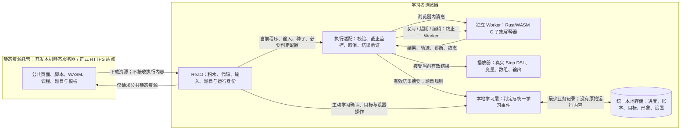

# 01.2 数据流与处理边界

版本：DEC-001 V1.0；日期：2026-10-14。  
依据：[执行位置决议](./01.2-执行位置与运行形态决议.md)、[01.1 基线](./01.1-一期范围与用户路径.md)。  
配套：[日志与数据保留](./01.2-日志与数据保留规则.md)。本图是设计，不是已经建立的运行链路。

## 1. 数据流图

线上站点提供下载所需的普通网络请求；执行内容仅在浏览器内部流动。托管方可观察公共资源请求和连接元数据，不能据“未上传代码”声称整站没有网络通信或访问行为完全不可见。

## 2. 数据位置与保存矩阵

| 数据 ID | 数据与产生位置 | 处理位置/传递对象 | 一期保存位置及期限 | 网络边界 |
|---|---|---|---|---|
| DATA-01 | 公共课程/题目/解析/案例/代码模板/积木映射、公共 WASM | 构建/发布配置流程；主线程读取，Worker 仅获必要执行/判定配置 | 发布静态文件及可重取的公共资源缓存；按发布版本更新 | 可从受控同源站点下载；公开模板不同于用户运行源码 |
| DATA-02 | 用户积木及最终显示/执行的 C 程序，浏览器主线程产生 | 主线程生成/检查；发送当前版本到 Worker，由 Rust 解析执行 | 工作区/当前运行内存；不自动存至 IndexedDB/localStorage/sessionStorage/Cache API | 不进 URL、HTTP 请求、错误上报或第三方脚本；浏览器内部消息允许 |
| DATA-03 | 手动输入、随机生成的实际输入与种子，浏览器产生 | 适配检查；Rust 再校验并绑定到真实模板；主线程显示同一输入 | 当前工作区/运行内存；重置、失效或关闭后不承诺恢复 | 不上传、不作为公共资源请求参数 |
| DATA-04 | AST、执行状态、虚拟对象/内存及步骤，Rust Worker 产生 | 只在本次 Worker 中执行；输出受限真实 Step DSL | 活动 Worker 内存；结果回传/取消/失败处置后实例释放 | 不访问宿主文件/网络/学习档案 |
| DATA-05 | 轨迹、输出、诊断（可能含代码片段/输入值），Rust 产生 | 返回主线程，先校验身份/版本/体积/结构，再由播放器展示和恢复 | 当前有效运行内存；回退/重播复用，不因此持久化 | 禁止日志、HTTP、遥测或异常自动上传 |
| DATA-06 | 题目通过/失败、学习确认、完成事件，浏览器学习层产生 | 按已验规则消费实际执行结果/题目配置；统一学习层做进度/奖励处理 | 浏览器统一业务存储，只保存必需标识、版本、结果摘要与事件信息；字段留 02.1/02.3 | 不发送给 Worker 或托管站点；结果不含原始源码/输入/轨迹 |
| DATA-07 | 进度、打卡、积分账本、头像、目标、显示设置等档案 | 统一本地学习层读写；可在本浏览器多标签协调 | 浏览器同源业务存储/偏好存储；保存成功后保留到主动清除/浏览器清理，方案与迁移由 02.3 | 不跨设备同步、不进学习状态 cookie、不建立服务端档案 |
| DATA-08 | 状态、错误码、耗时、体积等最少技术信息 | 页面/Worker 适配与测试工具；只记录不含用户内容的分类/计数 | 产品默认仅少量临时内存；持久监测和托管元数据按保留规则处理 | 不建立产品遥测上报通道；基础设施元数据另行核验 |
| DATA-09 | P1 编辑历史/断点/快照，P2 薄弱点/笔记/AI 上下文 | 对应后续模块，当前无实现 | 后续按 02.3、13.4、16.3、19.3、20.1 的决议；不能以预留字段提前收集 | AI 外发须单独启用；本决议不授权 |

正文位置规则为后续契约的约束，DATA 标识仅定位文档，不是存档/API 字段。Rust 只提供真实运行和必要结果，最终学习事件/奖励由浏览器学习层管理；09.3 仍须冻结可解释的题目测试/语义判定方式。

## 3. 运行生命周期与清理

当前题目/案例的工作区、复盘及内部返回共享一个仅在内存中的临时上下文，区别于服务端用户会话。页面/组件卸载不能单独决定是否丢弃该上下文；真正退出题目/案例、清空、刷新或关闭才结束它。编辑使旧运行失效的规则始终有效，不能用上下文保留冒充当前版本成功。

| 时点 | 执行与结果处理 | 学习记录/奖励处理 |
|---|---|---|
| 初始化 | 读公共资源并验证版本；创建受控调用环境。无可用模块时显示加载/调用故障，不假装可执行 | 读取本地已保存档案；读取失败明确提示 |
| 提交 | 固定当前程序/输入/内容/运行身份；清除旧运行画面并使旧身份失效；传入最少配置 | 不因点击提交或运行开始直接判题通过 |
| 正常结束 | 接收有界结果，校验当前身份/版本与轨迹；终止/释放运行 Worker；保留有效轨迹供播放 | 仅有效判定能产生统一事件；保存成功与临时通过分别表达 |
| 程序错误/超限 | 接受契约允许且验证通过的错误/有界前缀轨迹；明确终态；释放 Worker | 不是正常通过，无首次通过奖励 |
| 用户取消/主线程强制终止 | 主线程作取消/超期终态并废弃运行；不等待收尾、不拼造缺失轨迹；未验证部分结果丢弃 | 不新增通过；既有历史通过不受影响 |
| 修改源码/输入或切换案例 | 终止活动 Worker，旧身份失效；清除旧轨迹/输出及绑定输入副本，新代码仍属于工作区当前版本 | 不把旧响应当新提交结果；已保存历史仍标记原题/内容版本 |
| 后退/重播/切换基础视图 | 使用同一已验证轨迹，恢复完整状态；不再请求执行 | 不直接发首次完成/积分事件 |
| 同题目/案例内工作区→复盘→返回 | 保留只读提交快照、版本绑定的有效轨迹及工作区当前版本；返回仍属于同次提交。不改变源码/输入时内部切换不清理已接受结果；若终止未完成计算，则没有完整复盘 | 不因内部导航重新判定/奖励，不把已接受结果改成取消 |
| 真正退出题目/案例临时上下文、清空、关闭/刷新 | 终止当前 Worker，丢弃该上下文代码/输入、提交快照及执行缓存；浏览器实际内存回收由运行时管理 | 保留已成功保存的档案；未保存的临时结果不承诺刷新恢复 |

被主线程强制终止时，由适配层按触发原因产生取消、运行截止超限或基础设施故障的终态说明，不是伪造 Rust 教学步骤。Rust 已明确返回的运行错误或超限可以携带协议允许的真实前缀，两者在 02.2 区分。

## 4. 浏览器本地数据的实际边界

浏览器存储按 origin 隔离，同一 origin 包括协议、主机名与端口。因此开发端口/正式域名变化可能对应不同档案；迁域不自动搬迁，不显示“数据丢失”或“已同步”的虚假结论。稳定 origin 与内容/存档迁移策略由 03.1/02.3 固定。[MDN 同源与本地存储](https://developer.mozilla.org/en-US/docs/Web/Security/Defenses/Same-origin_policy)

浏览器本地数据仍可能被主动清除、存储压力或隐私模式清理；保存失败要明确反馈，不能承诺永久保留。本决议只固定位置和收集边界，存储选择、容量、损坏恢复、并发与事务由 02.3/04.1—04.3 实现。[MDN 配额与清理规则](https://developer.mozilla.org/en-US/docs/Web/API/Storage_API/Storage_quotas_and_eviction_criteria)

## 5. 用户可见说明基线

后续页面须结合实际实现使用如下含义，不能在当前尚无工程时声称能力已验证：

- 正常运行说明：“程序由此浏览器中的 Rust 解释器执行。平台不会将本次代码、输入和轨迹上传到执行服务器。网页及课程资源加载需要网络。”
- 本地保存说明：“进度、积分和设置保存在当前浏览器，不跨设备同步。清除网站数据可能删除这些记录；本次保存失败时会显示未保存。”
- 加载故障：“执行模块暂时无法加载，请检查资源加载并重试。”不得声称 Rust 服务离线或自动发送代码到远端。
- 课堂演示不写入虚假课题完成；演示事件、奖励判据仍按 01.1 与 02.1/11.1。
- 未来启用 AI 或导出文件时，应单独告知数据对象/目的地/动作，不用本地执行说明掩盖另一路发送。
