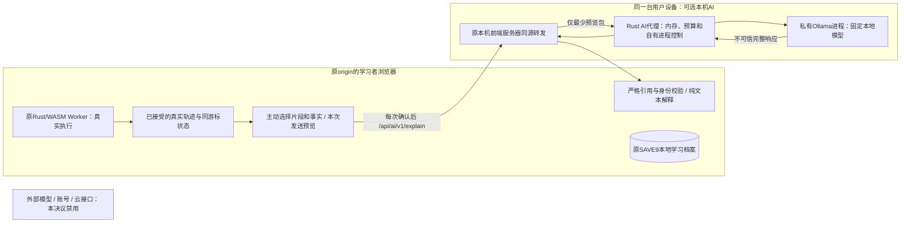

# 19.3 AI数据流与保留边界

AI-DATA-01 1.0.0；2026-11-01。配合[DEC-P2-011](./19.3-本机AI方案与最小数据边界.md)和[AI-EXPLAIN-01](../契约/19.3-AI解释上下文与响应契约.md)。**图与表为后继实施约束，本轮没有建立这条模型链路。** 原[DEC-001日志规则](./01.2-日志与数据保留规则.md)未改。

S不连接AI分支；不由服务端重读磁盘/IndexedDB，也不从草稿库或错题库自动补上下文。原始stdin原文和完整stdout不发送，但用户选定的当前变量可能包含输入导出的值，仍须逐值列入预览。静态资源下载和用户另行授权的运行器/模型下载仍可能访问互联网，它们不含当前源码/作答。图中同机HTTP会离开浏览器，但没有授权发送到其他机器。本地学习保存、同机临时传输与出机传输须分别解释。

| 对象 | 允许接收者 | 保存/失效规则 |
|---|---|---|
| 当前原文、完整轨迹/内存/输入/输出 | 原浏览器解释与播放；沿原工作台规则 | 不整份进入AI；原显式C草稿能力不变，不因启用AI读取或上传草稿历史。 |
| ≤2段源码、实际诊断、选定步骤/同游标最少值 | 本次预览；确认后仅同机转发、代理、固定Ollama | 内存中仅当前请求，60秒硬截止；完成、取消、失效、离页、清档/代理退出丢引用/缓冲。不得存请求体、响应体、片段、可逆编码或内容摘要哈希。 |
| 临时contextId/requestId/输入修订、运行/源码修订、游标 | 浏览器/代理用于一次响应关联；模型不需身份字段 | 不进入系统提示或模型用户正文，不持久化，不作为学习事件ID；页面lease/世代/epoch只在浏览器检查。 |
| 允许模型看到的内容 | 源码片段、factId及其实际数据、目的/版本常量 | 服务器构造一次system+user，无对话历史/tools/files/外部链接获取。用户在预览中能逐项看到数据，不自动扩选。 |
| 模型解释/建议 | 当前匹配上下文的浏览器；纯文本 | 没有修复成功/判题授权，无自动替换/运行；未知/过期引用整包拒绝；无模型历史存档或遥测。 |
| 代理/运行器版本、模型digest、错误码、分阶段耗时/字节数 | 本机少量临时技术状态 | 最多32条，内存有界；禁原始异常对象、请求/内容哈希、源/输入/轨迹或学习标识。退出清理，不建设遥测服务。 |
| 通道凭据 | 两个服务器进程 | 256位随机短期值，不给浏览器/模型、不入URL/前端变量/构建/日志；退出作废。没有模型API密钥或云登录。 |
| 公开模型权重/许可/运行器 | 用户批准的本机专用模型目录 | 可以留存公开静态文件；不在仓库，不混入用户请求；禁启动自动prune、后台pull、签到/云回退/自动更新。 |
| 学习档案、弱点summary、错题、奖励、用户画像、其他源码 | 仅原浏览器统一学习层 | 本协议没有对应字段；代理也无相应读取API或目录权限；拒绝额外字段，不靠“模型不保存”替代数据最小化。 |

本机模型也属于额外处理进程，不能仅用“本地保存”一句话代替预览。允许的界面文案如下（属于设计，不是已经存在的控件）：

> 本机AI当前未启用。启用需要另行安装模型。每次提问前会显示发送内容：选定代码片段、真实诊断与少量当前状态；它们只临时交给本机模型。本地学习档案不会发送。关闭AI不影响执行、单步和复习。

预览须列目的地“本机固定模型”、源码范围/字节数、每个fact与游标、输入/输出未包含状态；显示取消与“仅发送这次选定内容”，不以总开关授权未来所有请求。关闭后不能偷偷重试、改模型或加载完整源码。若未来转外部服务，需新版决议和**另一份明确的外部接收方/保留/费用预览授权**；已有本机确认不适用。

`keep_alive=0`只涉及模型保活，并不是请求数据物理擦除保证。固定运行器的请求debug开关可落盘，必须显式关闭并监测；禁止代理/前端转储原始请求、错误正文、stdout/stderr或浏览器console。引用丢弃/进程终止不承诺操作系统页面、交换区或设备缓存被安全擦除，也不擅自修改用户系统设置。19.4/19.5须以自有教学输入检查磁盘/网络/日志，没有实测不能写“已证明绝不落盘/绝不传输”。
